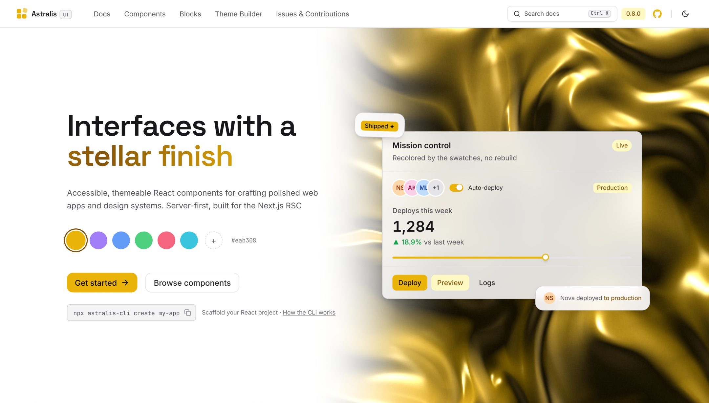

<div align="center">

<a href="https://astralis-ui.com">
  <picture>
    <source media="(prefers-color-scheme: dark)" srcset=".github/assets/logo-dark.png">
    
  </picture>
</a>

<h3>Interfaces with a stellar finish</h3>

<p>Accessible, themeable React components for polished web apps and design systems.<br>Server-first, with the tooling to set it up, theme it and keep it right.</p>

[](https://www.npmjs.com/package/astralis-ui)
[](https://github.com/sekiro-9/astralis-ui/actions/workflows/ci.yml)
[](https://react.dev)
[](LICENSE)
[](https://astralis-ui.com)

[Documentation](https://astralis-ui.com/docs) ·
[Components](https://astralis-ui.com/docs/components/button) ·
[Blocks](https://astralis-ui.com/blocks) ·
[Theme builder](https://astralis-ui.com/theme-builder) ·
[Changelog](packages/astralis-ui/CHANGELOG.md) ·
[Report a bug](https://github.com/sekiro-9/astralis-ui/issues/new?template=1.bug.yml)

</div>

<br>

<a href="https://astralis-ui.com">
  <picture>
    <source media="(prefers-color-scheme: dark)" srcset=".github/assets/hero-dark.jpg">
    
  </picture>
</a>

## Why Astralis

- **80+ accessible components.** Layout, typography, forms, overlays, navigation,
  data display and feedback, each following its WAI-ARIA pattern with full
  keyboard support, documented key by key.
- **Server-first.** Most components are React Server Components that ship no
  client JavaScript at all. The interactive ones hydrate only where they must.
- **One colour, a whole theme.** Give the provider a brand colour and it derives
  the full palette, hover states and readable text colours. Visitors can switch
  brand at run time and keep their choice.
- **No build setup.** One precompiled stylesheet, no Tailwind config, no
  plugins. It sits beside whatever styling your app already uses.
- **Style props that scale.** `p={{ base: "4", md: "8" }}`, container queries
  with `@md`, hover and focus states, and any CSS value when a token is not
  enough.
- **Checked, not hoped.** The build fails if a class is missing from the
  stylesheet or a colour pairing drops below WCAG AA, in light and dark.

## Quick start

**New project.** Scaffolds Next.js or Vite with Astralis wired in:

```bash
npm create astralis my-app
```

**Existing project.** Detects Next.js or Vite, installs the package and mounts
the provider:

```bash
npx astralis-cli init
```

**By hand:**

```bash
npm install astralis-ui
```

```tsx
import { AstralisProvider } from "astralis-ui";
import "astralis-ui/styles.css";

export default function App({ children }) {
  return <AstralisProvider defaultTheme="system">{children}</AstralisProvider>;
}
```

Then build with it:

```tsx
import { Button, Card, Field, Input, VStack } from "astralis-ui";

export function SignUp() {
  return (
    <Card>
      <Card.Header>
        <Card.Title>Create account</Card.Title>
      </Card.Header>
      <Card.Body>
        <VStack gap="4">
          <Field required>
            <Field.Label>Email</Field.Label>
            <Input type="email" placeholder="you@example.com" />
          </Field>
          <Button colorScheme="brand" fullWidth>Sign up</Button>
        </VStack>
      </Card.Body>
    </Card>
  );
}
```

Requires React 19. With server rendering, add `<ThemeScript />` to `<head>` so
dark mode never flashes; the [installation guide](https://astralis-ui.com/docs/installation)
covers Next.js and Vite step by step.

## Packages

| Package | Version | What it does |
| --- | --- | --- |
| [`astralis-ui`](packages/astralis-ui) | [](https://www.npmjs.com/package/astralis-ui) | The component library |
| [`astralis-cli`](packages/astralis-cli) | [](https://www.npmjs.com/package/astralis-cli) | Create and set up projects, add blocks, generate themes, check your code against the library |
| [`create-astralis`](packages/create-astralis) | [](https://www.npmjs.com/package/create-astralis) | `npm create astralis`: a new project in one command |
| [`astralis-mcp`](packages/astralis-mcp) | [](https://www.npmjs.com/package/astralis-mcp) | Gives AI coding assistants the docs, the blocks and a way to check their code |
| [`astralis-devtools`](packages/astralis-devtools) | [](https://www.npmjs.com/package/astralis-devtools) | A development overlay: inspect any component on the page, Server Components included |

The repository also holds the [blocks](packages/astralis-blocks) (37 ready-made
sections, from heroes to dashboards, copied into your project with
`npx astralis-cli add hero-01`) and the [docs site](packages/astralis-docs).

## Works with your AI assistant

Connect the MCP server and your assistant reads the real docs, finds the right
block, and checks the code it writes before you see it:

```bash
npx astralis-cli connect-mcp
```

It walks you through Claude Code, Codex, Cursor, Claude Desktop and
Antigravity. Every docs page is also available as plain markdown, indexed at
[`/llms.txt`](https://astralis-ui.com/llms.txt).

## Contributing

Bug reports, fixes and ideas are welcome. Start with the
[contributing guide](CONTRIBUTING.md); it covers setup, the commands, and how a
component goes from source to docs. Everyone taking part follows the
[code of conduct](CODE_OF_CONDUCT.md).

Found a security problem? Please report it privately, as described in the
[security policy](SECURITY.md).

## Changelog

Each package keeps its own:
[astralis-ui](packages/astralis-ui/CHANGELOG.md) ·
[astralis-cli](packages/astralis-cli/CHANGELOG.md) ·
[astralis-mcp](packages/astralis-mcp/CHANGELOG.md) ·
[astralis-devtools](packages/astralis-devtools/CHANGELOG.md) ·
[create-astralis](packages/create-astralis/CHANGELOG.md).
Every published version also has a [GitHub release](https://github.com/sekiro-9/astralis-ui/releases).

## License

[MIT](LICENSE) © 2026 Paul Andrew
